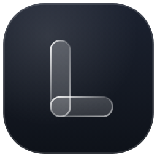

<p align="center"></p>

<h1 align="center">Lurt</h1>

<p align="center">
  <a href="https://github.com/ladroxd/Lurt/releases/latest/download/lurt.exe">
    
  </a>
</p>
<p align="center">
  
  
  
  
</p>
<p align="center"><sub>No installer: download <code>lurt.exe</code> and run it. <a href="https://github.com/ladroxd/Lurt/releases">All releases</a></sub></p>

A light, fast browser for Windows, written in Rust, with a liquid-glass interface.

- **Engine:** the WebView2 (Chromium) runtime that ships with Windows, so there is no bundled browser engine. `lurt.exe` is about 6 MB.
- **Window:** [tao](https://crates.io/crates/tao) + [wry](https://crates.io/crates/wry), borderless with a native blur/acrylic/mica backdrop.
- **Tabs:** one WebView2 per awake tab, all sharing one engine process. New tabs and restored tabs cost nothing until you open them, and idle background tabs go to sleep.
- **Blocking:** Brave's [adblock-rust](https://crates.io/crates/adblock) engine (EasyList, EasyPrivacy, Peter Lowe's list) on every network request, plus cosmetic filtering and WebView2's built-in tracking prevention.

## Run

```powershell
cargo run --release                 # build and start
target\release\lurt.exe github.com  # open a page (or search terms) in a new tab
```

## Startup

The window appears in about 30 ms with a shimmering skeleton of the UI, drawn natively while the WebView2 engine starts underneath (0.3 s warm, a few seconds on the first launch after boot), then fades into the real interface. New tabs show a page skeleton instead of a white flash until the site has content.

`LURT_BENCH=1` prints startup timings to stderr without showing a window. `LURT_DATA=<dir>` uses a separate profile.

## Your data

Settings → Your data imports bookmarks and history:

- from Chrome, Edge, Brave, Vivaldi and Opera profiles on this PC (one profile, or all of them at once);
- from Google Takeout (`BrowserHistory.json`, `Bookmarks.html`) or any bookmarks `.html` export.

Passwords and signed-in sessions can't be imported, because Chromium encrypts them for the browser that saved them. Lurt saves passwords and autofill data itself once you sign in.

## Shortcuts

| Keys | Action |
| --- | --- |
| Ctrl+T / Ctrl+W | New / close tab |
| Ctrl+Shift+T | Reopen closed tab |
| Ctrl+Tab, Ctrl+1…9 | Switch tabs |
| Ctrl+L, Alt+D, F6 | Address bar (Alt+Enter opens in a new tab) |
| Ctrl+D | Bookmark page |
| Ctrl+H / Ctrl+Shift+O / Ctrl+, | History / All bookmarks / Settings |
| Ctrl+Shift+B | Show or hide the bookmarks bar |
| F5, Alt+←/→ | Reload, back/forward |

## Mods

`%APPDATA%\Lurt\mods` (Settings → Mods → Open mods folder):

- `ui\*.css`: restyle the browser. Every visual property is a CSS variable (`--r`, `--accent`, `--tint`, `--g1`, `--g2`, …) in `ui/style.css`.
- `sites\all.css`, `sites\all.js`: apply to every website.
- `sites\<domain>.css` / `.js`: apply to one site and its subdomains, e.g. `youtube.com.css`.

## Layout

```
src/main.rs     window, event loop, tab management, UI <-> Rust messages
src/tabs.rs     page views + WebView2 hooks (blocking, fullscreen, history, snapshots)
src/blocker.rs  filter list download / cache / engine
src/splash.rs   native startup skeleton (per-pixel-alpha window, software-rendered)
src/importer.rs bookmarks/history import from other browsers and Google Takeout
src/store.rs    settings.json, SQLite history + bookmarks, session, mods
src/glass.rs    window backdrop, rounded page corners
src/content.js  tiny script injected into websites (shortcuts, favicon, DOM-ready)
ui/             the browser interface (HTML/CSS/JS, compiled into the exe)
```

Data lives in `%APPDATA%\Lurt` (settings, history, mods) and `%LOCALAPPDATA%\Lurt\WebView` (cookies, cache).
